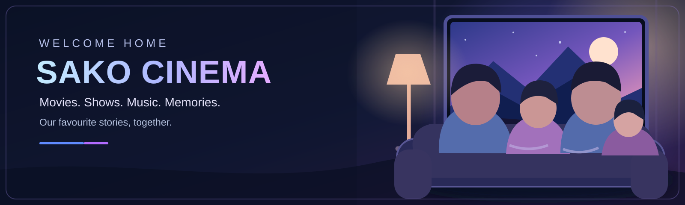

# SAKO Cinema Theme 🎬

A free, open-source **family cinema look for Jellyfin Web**: deep navy, electric blue, violet, subtle magenta, cinema-style library cards, a family movie-night banner, and an optional standalone visual preview. Built on top of ElegantFin.

**Current version:** 0.2.0 (preview release / testing required).



## Install: one CSS import

In **Jellyfin Dashboard → General → Custom CSS**, **replace** the current ElegantFin import (do not keep both imports) with:

```css
@import url("https://cdn.jsdelivr.net/gh/Sako404/SAKO-Cinema-Theme@main/theme.css");
```

Save and hard refresh the browser (Ctrl+Shift+R). jsDelivr's `@main` may be cached for a while, and Jellyfin may keep local CSS cache. The theme already imports ElegantFin.

### Undo

Simply restore your previous ElegantFin import:

```css
@import url("https://cdn.jsdelivr.net/gh/lscambo13/ElegantFin@main/Theme/ElegantFin-jellyfin-theme-build-latest-minified.css");
```

## Project files

- [theme.css](theme.css) — complete installable CSS with ElegantFin import
- [Family cinema banner](artwork/family-cinema-banner.svg) — original SVG family illustration for the home hero
- [Library artwork](artwork/libraries/) — **9 different permanent library images** (including adult library art for personal use)
- [Artwork guide](artwork/README.md) — how to assign covers directly to Jellyfin libraries
- [Standalone visual preview](preview.html) — mockup showing the intended layout (not a live Jellyfin client)
- [License](LICENSE) / [Changelog](CHANGELOG.md)

## What works where?

| Client | CSS visuals | Permanently assigned library artwork |
| --- | --- | --- |
| Jellyfin Web / web browser | Yes | Yes |
| Family Command Center opening Jellyfin Web | Yes | Yes |
| Amazon Fire TV Cube native Jellyfin app | No | Generally yes, depending on format/client |
| Google TV native Jellyfin app | No | Generally yes, depending on format/client |

The native TV app does not load the server's Custom CSS. The artwork is separate, so it can still be used on TV.

## Important limitations

- This is a **real CSS theme**, not a replacement of the Jellyfin Web application. It cannot reproduce all layout elements of the concept image, such as a functioning custom sidebar or new navigation. The banner and enhanced cards are real CSS additions; they rely on Jellyfin's actual HTML selectors and need testing on your version.
- The original SVG family artwork is an **illustration**, not a photographic likeness or portrait of actual household members.
- These library SVGs can be converted to PNG/JPEG if Jellyfin rejects SVG uploads.
- Library access is managed entirely by Jellyfin user permissions. Do not use CSS to hide adult libraries.
- ElegantFin is a separate upstream CSS dependency, currently imported via `@main`. This is convenient but can change without warning. Pin a tested upstream commit and release tag before calling it stable production.
- Do not publish private home media, screenshots with personal details, tokens, or real family photos in issues or pull requests.

## Visual direction

Elegant premium home cinema, not a gaming dashboard: dark navy backgrounds, electric blue/violet focus indicators, restrained glow, softer cards, visible keyboard focus, mobile adjustments, and reduced-motion handling. **No gold branding.**

## Contributing

Issues and pull requests are welcome. Include Jellyfin version, web browser, screen size, reproducible issue, and a screenshot without sensitive media/user details.

MIT for the original theme/source. ElegantFin retains its own upstream licensing.
