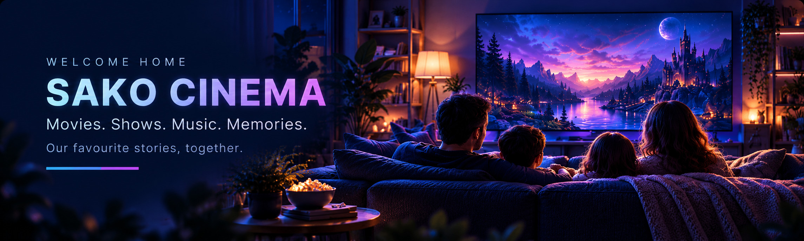

# SAKO Cinema Theme 🎬

Public, free family-oriented theme for **Jellyfin Web**, built on ElegantFin. Navy, blue, violet, magenta and cozy home cinema artwork. No gold.



## Install (single CSS import)

In **Jellyfin Dashboard → Branding → Custom CSS**, replace existing custom CSS with:

```css
@import url("https://cdn.jsdelivr.net/gh/Sako404/SAKO-Cinema-Theme@v1.1.0-rc.1/theme.css");
```

Save, then reload Jellyfin Web with Ctrl+Shift+R. This stylesheet already imports ElegantFin. Do not import ElegantFin a second time or paste the earlier v0.5 override blocks underneath.

Always import a **release tag** (for example `@v1.1.0-rc.1`), never a branch. A tag is immutable, so every viewer gets exactly that release. To update, change the version number in both lines and reload with Ctrl+Shift+R. The current release is listed under [Tags](https://github.com/Sako404/SAKO-Cinema-Theme/tags).

Do not use `@main` or an address without a version. jsDelivr caches which commit a branch points to separately on each edge server, and a purge does not reliably clear that. On 2026-10-19 `@main` served one browser a months-old `theme.css` while another location got the current one.

To freeze an exact commit instead of a tag:

```css
@import url("https://cdn.jsdelivr.net/gh/Sako404/SAKO-Cinema-Theme@e2462dd34605658abbd2ff02506dd0904b5a81fc/theme.css");
```

**Rollback:** previous release candidate (1.0.0-rc1):

```css
@import url("https://cdn.jsdelivr.net/gh/Sako404/SAKO-Cinema-Theme@0d6745cd7034b49b2213f4a1b8af988636fc8651/theme.css");
```

or the earlier working v0.6.1 version:

```css
@import url("https://cdn.jsdelivr.net/gh/Sako404/SAKO-Cinema-Theme@2bb4583dc36a057a9e360f9da8cc82bbd614e620/theme.css");
```

## Optional: SAKO layout module

`layout.css` moves the page closer to the SAKO Cinema mockup: a left sidebar built from Jellyfin's own library navigation, a full-width home hero with the library tiles laid over its lower edge, a tile grid for My Media, and panel-style Continue Watching cards. Add it as a **second** line, below the theme:

```css
@import url("https://cdn.jsdelivr.net/gh/Sako404/SAKO-Cinema-Theme@v1.1.0-rc.1/theme.css");
@import url("https://cdn.jsdelivr.net/gh/Sako404/SAKO-Cinema-Theme@v1.1.0-rc.1/layout.css");
```

Delete the second line to return to the standard layout. Nothing else changes.

How it behaves on different devices:

- **Desktop, 1100px and wider:** sidebar on the left. The sidebar is hidden in the video player.
- **Tablet and phone:** the standard Jellyfin top bar or menu stays. The hero runs edge to edge and the library tiles wrap into 2–3 columns.
- **Jellyfin TV layout** (`layout-tv`, remote/D-pad navigation): no sidebar, so remote navigation behaves as in stock Jellyfin.
- **Native Jellyfin apps on Android TV, Fire TV and Google TV:** custom CSS is ignored. Only the library artwork stored on the server carries over.
- **Browsers without CSS `:has()`** (for example an older Jellyfin Media Player): no sidebar, the standard top bar stays.

The home styling assumes Jellyfin's default section order: **My Media** first, **Continue Watching** second (Settings → Home).

## What is included

- Clean CSS with one set of rules for home hero, card visuals, progress and headings
- Layout refinements for Jellyfin Web home, browse and detail pages
- Focus visibility, mobile adjustments and reduced-motion preference
- New cinematic family hero (JPG) and nine permanent cover images
- [Library artwork](artwork/libraries/) and [artwork installation script](scripts/install-library-artwork.py)

Original media-library covers should be assigned in Jellyfin as **Primary** images rather than replaced with CSS. They then persist through style updates and may be displayed by native TV clients.

## Scope and limitations

The original mockup is a *visual design reference*, not a pixel-perfect Jellyfin implementation. This is **CSS layered on existing Jellyfin Web**, not a replacement web app. It preserves actual navigation and functionality; a different functional sidebar, new recommendations engine, or custom menu hierarchy would require client development rather than CSS.

Native Jellyfin apps on Fire TV/Google TV do not apply web CSS. Artwork is stored on the server and can carry across where the native clients support it.

Jellyfin permissions must control access to private/adult libraries. CSS is not a security boundary. Never put API keys or private family photos in public repository content.

**Release status:** v1.0.0-rc2. Checked in desktop Chrome on the owner's Jellyfin (home, library browse, item details) and on a 400px-wide mobile viewport; not yet checked on the login page, the video player, or other browsers. ElegantFin is pinned to release v26.09.05 (commit `5efc110`), so the import is reproducible.

## Maintainers

Original CSS/docs/artwork: MIT (see LICENSE). ElegantFin is a separate dependency under its upstream licence. Contributions and screenshots without sensitive information welcome.
