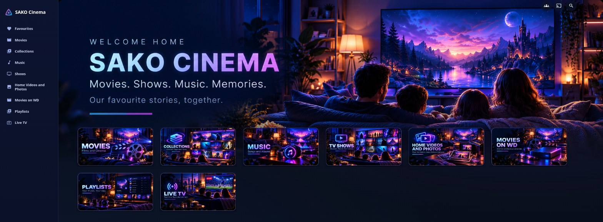
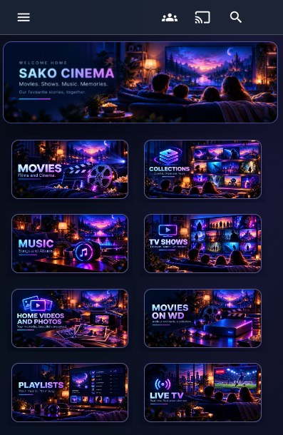
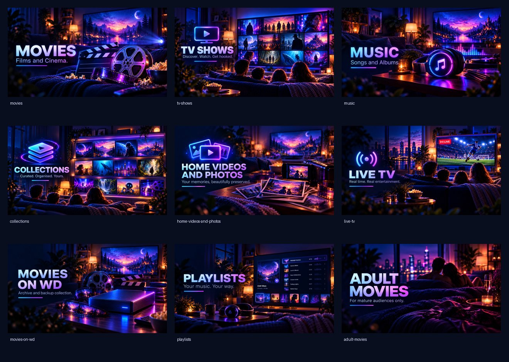

<div align="center">


# SAKO Cinema Theme

**A cozy family-cinema look for Jellyfin Web.** Navy, electric blue, violet and magenta, with hand-made library artwork. No gold.

[](https://github.com/Sako404/SAKO-Cinema-Theme/releases/latest)
[](https://jellyfin.org)
[](https://github.com/lscambo13/ElegantFin)
[](LICENSE)

</div>

---

## Preview

<table>
<tr>
<td width="78%"></td>
<td width="22%"></td>
</tr>
<tr>
<td align="center"><sub>Desktop, with the optional layout module</sub></td>
<td align="center"><sub>Phone</sub></td>
</tr>
</table>

## Install in one minute

1. Open **Jellyfin → Dashboard → Branding → Custom CSS**.
2. Replace its contents with:

```css
@import url("https://cdn.jsdelivr.net/gh/Sako404/SAKO-Cinema-Theme@v1.2.0/theme.css");
@import url("https://cdn.jsdelivr.net/gh/Sako404/SAKO-Cinema-Theme@v1.2.0/layout.css");
```

3. Save, then reload Jellyfin with **Ctrl+Shift+R**.

The second line is **optional**. Leave it out to keep Jellyfin's standard layout with the SAKO colours and cards. `theme.css` already includes ElegantFin, so don't import ElegantFin separately.

> [!IMPORTANT]
> Always import a **release tag** such as `@v1.2.0`, never `@main` and never an address without a version. jsDelivr can keep serving an old commit for a branch on some of its servers, even after a purge. Tags never change. To update, change the version number in both lines. Releases are listed under [Releases](https://github.com/Sako404/SAKO-Cinema-Theme/releases).

## Your own hero title

From 1.2.0 the hero image has no text baked in. The title is drawn by CSS, so you can put your own name on it. Add any of these lines **after** the imports:

```css
:root {
  --sako-hero-title: "Smith Family Cinema";
  --sako-hero-kicker: "Welcome home";
  --sako-hero-subtitle: "Movies. Shows. Music. Memories.";
  --sako-hero-tagline: "Our favourite stories, together.";
}
```

Set only the ones you want to change. Without them you get *SAKO Cinema* and the default lines. An empty value (`""`) hides that line. The title is shown in capitals. On phones only the title is shown.

### Use your server's name automatically

CSS can't read the Jellyfin server name by itself. `scripts/set-hero-title.py` does it for you: it reads the name from your server and writes the `--sako-hero-title` line into Custom CSS. It needs Python 3 and nothing else. Download it from this repository, then preview the change first (no key needed, nothing is written):

```
python3 set-hero-title.py --url http://YOUR-SERVER:8096 --dry-run
```

Then apply it. It asks for an admin API key (**Dashboard → API Keys**), backs up your branding settings and asks you to type `APPLY`:

```
python3 set-hero-title.py --url http://YOUR-SERVER:8096 --apply
```

Run it again after renaming the server; it replaces its own line instead of adding another. `--title "Any text"` uses your own text instead of the server name, and `--restore <backup file>` undoes the change. Delete the API key afterwards if you created it only for this.

## What you get

| | `theme.css`: colours and cards | `layout.css`: optional layout |
|---|---|---|
| **Home** | Hero banner, aligned section headings, rounded cards with a violet edge and a hover glow | Left sidebar, edge-to-edge hero, library tiles over the hero, one panel style for every row |
| **Libraries** | Gradient *Play All*, violet count chip and badges, card outline and glow | Grid that fills the full width next to the sidebar |
| **Item details** | Backdrop visible behind a navy scrim, gradient *Play* button, glass action buttons, tinted info panels | n/a |
| **Everywhere** | Visible keyboard focus, respects reduced-motion, mobile adjustments | Sidebar from 1100px; phones and tablets keep the normal menu |

## Library artwork

Nine matching covers for typical libraries: Movies, TV Shows, Music, Collections, Home Videos & Photos, Live TV, Playlists, a second movie drive and an adults-only library.



Set them as each library's **Primary** image in Jellyfin rather than overriding them with CSS. They then survive theme updates and also show up in the **native TV apps**. You can upload them by hand in the library image editor, or use the optional installer, which makes a dry run and a backup first. See [Library artwork setup](ARTWORK-DEPLOYMENT.md).

## Works on

| Client | Result |
|---|---|
| Desktop browser (Chrome, Edge) | Full theme and layout. Tested. |
| Phone browser and the Jellyfin mobile apps | Theme plus mobile layout, without the sidebar. Confirmed working by the owner. |
| Jellyfin web in TV mode (remote / D-pad) | Theme, without the sidebar, so remote navigation stays stock |
| Native Android TV, Fire TV and Google TV apps | Custom CSS is ignored. You still get the **library artwork**. |
| Firefox, Safari, Jellyfin Media Player | Not tested yet. Without CSS `:has()` support the sidebar stays off and the standard top bar is used. |

## Recommended Jellyfin settings

These are optional, but they get closest to the intended look:

- **Settings → Home:** keep the section order *My Media* (or *My Media (small)*), *Continue Watching*, *Next Up*, *Recently Added*. This is Jellyfin's default. The layout module expects My Media first and Continue Watching second.
- **Settings → Home:** hide rarely used libraries from *My Media*, so six tiles fill one row. Jellyfin then also removes them from the navigation (sidebar). Open them through search or *Favourites* instead.
- **Settings → Display → Next Up:** turn on *Use episode images in 'Next Up' and 'Continue Watching' sections* for wide episode thumbnails.
- **Dashboard → General:** set the *Server name* you want shown at the top of the sidebar.

## Updating and rollback

To update, change the tag in both lines (for example `@v1.1.0` → `@v1.2.0`). Your own `:root { --sako-hero-… }` lines stay as they are and reload with Ctrl+Shift+R.

<details>
<summary>Roll back to an earlier version</summary>

1.1.0 (title baked into the hero image; `--sako-hero-*` lines have no effect):

```css
@import url("https://cdn.jsdelivr.net/gh/Sako404/SAKO-Cinema-Theme@v1.1.0/theme.css");
@import url("https://cdn.jsdelivr.net/gh/Sako404/SAKO-Cinema-Theme@v1.1.0/layout.css");
```

1.0.0-rc1:

```css
@import url("https://cdn.jsdelivr.net/gh/Sako404/SAKO-Cinema-Theme@0d6745cd7034b49b2213f4a1b8af988636fc8651/theme.css");
```

0.6.1:

```css
@import url("https://cdn.jsdelivr.net/gh/Sako404/SAKO-Cinema-Theme@2bb4583dc36a057a9e360f9da8cc82bbd614e620/theme.css");
```

To freeze one exact commit instead of a tag, use its full SHA, for example `@8402ea0f9e725cf9eed9defccfc5a79fab54b0a8`.

</details>

## Limits

- This is **CSS on top of Jellyfin Web**, not a separate app. The sidebar entries, their order and their names come from Jellyfin itself.
- The **login page** keeps the base styling.
- *Recently Added* shows movie posters in portrait format. Jellyfin chooses the image type, and CSS can't change it.
- Jellyfin user permissions control who sees which library. **CSS is not a security boundary.**

## Repository

```
theme.css                      colours, cards and pages (required)
layout.css                     sidebar and home layout (optional)
artwork/                       hero banner and library covers (JPG + SVG source)
scripts/install-library-artwork.py   optional API installer for library covers
scripts/set-hero-title.py            optional: hero title from the server name
docs/screenshots/              images used in this README
CHANGELOG.md                   release notes
```

## Credits and license

Original CSS, documentation and artwork are released under the MIT license (see [LICENSE](LICENSE)). [ElegantFin](https://github.com/lscambo13/ElegantFin) is a separate upstream project under its own license, pinned to release v26.09.05. Screenshots in this repository contain no private media. Please keep it that way in contributions.
